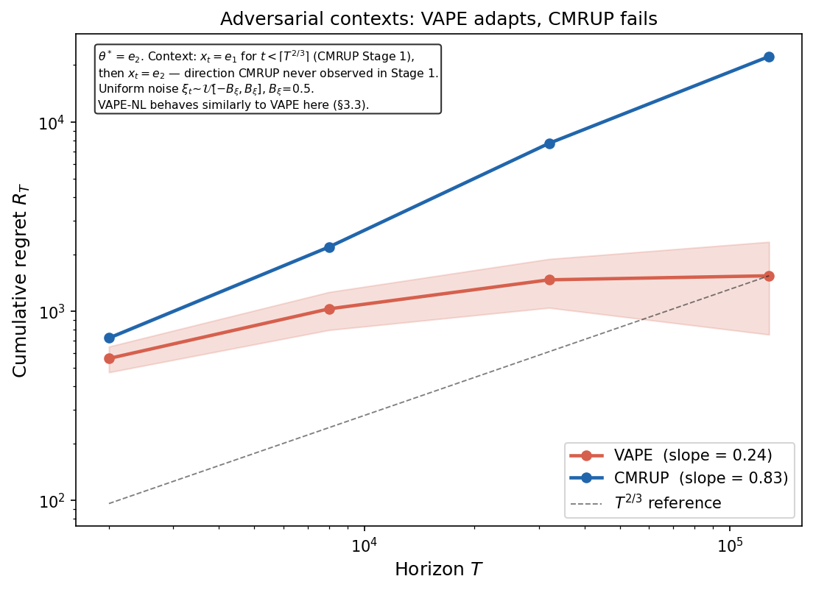

# Contextual Dynamic Pricing: VAPE under Structured and Adversarial Contexts

Simulation code for my research internship report *Towards Sharper Regret Bounds in Contextual
Dynamic Pricing* (ENSTA Paris, 2026).

A seller sees a product context $x_t \in \mathbb{R}^d$ and posts a price $p_t$. The buyer's
valuation is $y_t = x_t^\top \theta^* + \xi_t$, with $\theta^*$ unknown, and the seller only
observes whether the item sold ($p_t \le y_t$). The goal is to keep the cumulative regret
$R_T$, compared with always posting the best price, as small as possible.

This repository studies **VAPE** (Valuation Approximation + Price Elimination) and a
non-Lipschitz variant, **VAPE-NL**. It compares them with **CMRUP**, an
explore-then-commit baseline that estimates $\theta^*$ once at the start.

<p align="center">
  
</p>

## Key results

| Setting | VAPE | CMRUP | Takeaway |
|---|---|---|---|
| Adversarial contexts, $T$ up to 128k | $R_T \approx 1.5 \times 10^3$, slope 0.24 | $R_T \approx 2.2 \times 10^4$, slope 0.83 | VAPE keeps learning online; CMRUP never sees the direction that matters |
| i.i.d. contexts, uniform noise | slope 0.62 | slope 0.63, lower $R_T$ | When contexts are i.i.d., the explore-then-commit baseline is hard to beat |
| i.i.d. contexts, cliff (non-Lipschitz) noise | slope 0.69 | slope 0.80 | CMRUP's advantage shrinks as $T$ grows |

Slopes are fitted on log-log plots of $R_T$ against $T$, using the mean over 15 seeds. A slope
below 1 means the regret grows sub-linearly.

**In short:** VAPE's advantage comes from its **online gatekeeper**. It keeps exploring only in
the directions where its estimate is still uncertain. That makes it robust when the context
distribution shifts. The cost is a small overhead when the contexts are i.i.d. and well spread.

## How VAPE works

Each round, a **gatekeeper** compares the uncertainty of the current context,
$\lVert x_t \rVert_{V_{t-1}^{-1}}$, with a threshold $\mu$:

- **Valuation approximation (exploration):** if the context lies in an uncertain direction,
  VAPE posts an exploratory price and updates a ridge estimate of $\theta^*$. The inverse is
  updated in $O(d^2)$ with Sherman-Morrison.
- **Price elimination (exploitation):** otherwise it prices using the current estimate,
  eliminating prices whose upper confidence bound is dominated.

The report's Chapter 2 shows how the structure of the contexts (a single direction, a sparse
support, correlation, a probabilistic subspace) changes the effective dimension in the
regret bound. Chapter 3 compares the algorithms.

## Repository structure

```
experiments/
  ch2_context_structures.py      regret, exploration and spectrum of V_t under 5 context structures
  ch2_confidence_ellipsoids.py   confidence ellipsoid snapshots and supporting diagnostics
  ch2_probabilistic_subspace.py  effective dimension when contexts leave a subspace with probability δ
  ch3_vape_vs_cmrup.py           VAPE vs CMRUP vs VAPE-NL, i.i.d. and adversarial, 2 noise models
  ch3_adversarial_a.py           adversarial contexts, uniform noise (figure above)
  ch3_adversarial_b.py           adversarial contexts, cliff noise
figures/                         figures used in the report
outputs/                         created when you run a script (not tracked)
```

## Reproduce

Python 3.10+.

```bash
pip install -r requirements.txt
python experiments/ch3_adversarial_a.py
```

Each script writes its figures to `outputs/<script name>/` and prints a numerical summary.
Every experiment uses fixed seeds. The longest runs take a few minutes on a laptop CPU.

| Figure | Script |
|---|---|
| `ch3_adversarial.png` | `ch3_adversarial_a.py` |
| `ch3_adversarial_B.png` | `ch3_adversarial_b.py` |
| `ch3_iid_comparison.png`, `ch3_adversarial_A.png` | `ch3_vape_vs_cmrup.py` |
| `logdet_all.png`, `eigenvalues_grid.png`, `exploration_all.png`, `regret_all.png`, `rate_check.png`, `corr_validation.png` | `ch2_context_structures.py` |
| `ellipsoid_*.png`, `block_epl.png`, `eta_necessary.png`, `lambda_min_global.png` | `ch2_confidence_ellipsoids.py` |
| `block_diagonal_Vt.png`, `bernstein_concentration.png`, `effective_L_regimes.png` | `ch2_probabilistic_subspace.py` |

## Limitations

- **Simulations only:** the contexts and valuations are synthetic, with no real pricing data.
- **Tuned threshold:** the gatekeeper threshold is tuned ($\mu = 0.05$). The theoretical value
  only becomes practical at horizons near $10^6$.
- **Simplified price elimination:** in the adversarial experiments, the price-elimination
  phase uses greedy UCB. The Lipschitz correction from the theory is too conservative at
  these horizons.
- **Short horizons in Chapter 2:** at $T \le 3200$ the Chapter 2 runs are still
  pre-asymptotic, so the fitted slopes there are above the $2/3$ rate.

## License

[MIT](LICENSE)
